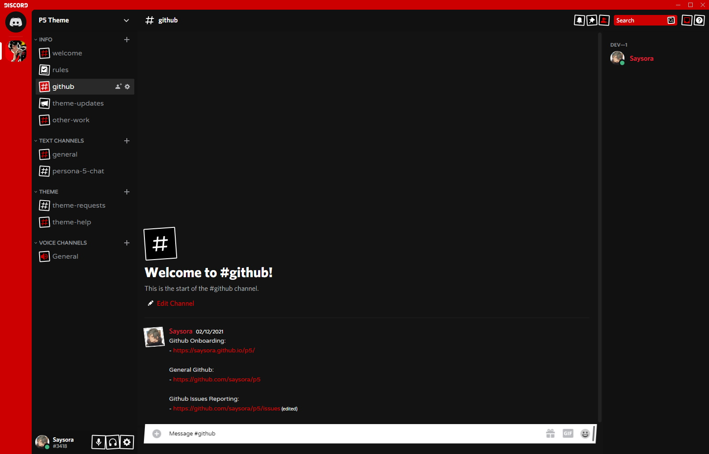

# Persona 5 Better Discord theme

## Features

- Darker UI
- Persona 5 Color Scheme
- All assets (fonts, backgrounds, images) self-hosted
- Persona fonts for inputs and message areas
- Skewed inputs for that Persona 5 feel

## Installation

Download `P5.theme.css` from the [theme page](https://air-wickk.github.io/p5-theme/) and put it in your BetterDiscord themes folder.
Typically located at `/USERNAME/AppData/Roaming/betterdiscord/themes/`

## Roadmap

See [ROADMAP.md](ROADMAP.md) for what's coming next in the 2.0.0 line.

## Credits

Original theme by [saysora](https://github.com/saysora), continued by air-wickk.

Atlus obviously for Persona.

_Date font_ is P5 Hatty (p5hatty) credited to HattyMikune and ToxicDevil from YouTube.
_Message font_ is Personified UX Regular credited to MV33izawsm.

## Questions

Feel free to open an issue here on GitHub if you're having trouble with the theme.
